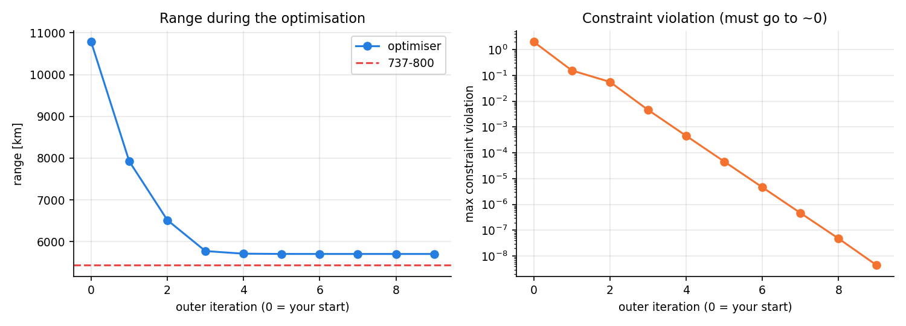
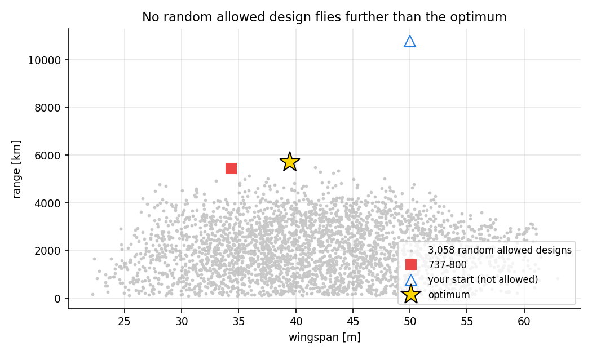

# Aircraft range optimiser: demo run 'bad_start'

_Generated by scripts/demo_report.py on 2026-11-26 20:18. Augmented Lagrangian + BFGS (our own code), checked with SciPy SLSQP._

## Your inputs

| Input | Value | 737-800 default |
|---|---|---|
| Passengers (100 kg each incl. bags) | 162 | 162 |
| Maximum take-off mass [kg] | 79,016 | 79,016 |
| Cruise altitude [ft] | 35,000 | 35,000 |
| Engine fuel burn factor | 1.0 | 1.0 |
| Maximum stall speed [m/s] | 64.0 | 64.0 |
| Maximum cruise Mach | 0.8 | 0.8 |
| Wing structure factor | 1.0 | 1.0 |
| Maximum wingspan [m] | no limit | no limit |
| Start: wingspan [m] | 50.0 | 34.32 |
| Start: wing area [m²] | 100.0 | 124.6 |
| Start: cruise Mach | 0.785 | 0.785 |
| Start: cruise fuel [kg] | 25,000 | 17,000 |

## Designs

|  | Your start | 737-800 | Optimum |
|---|---|---|---|
| Range [km] | 10,784 | 5,436 | 5,705 |
| Wingspan [m] | 50.0 | 34.3 | 39.5 |
| Wing area [m²] | 100.0 | 124.6 | 132.4 |
| Aspect ratio | 25.00 | 9.45 | 11.77 |
| Cruise Mach | 0.785 | 0.785 | 0.800 |
| Cruise fuel [kg] | 25,000 | 18,316 | 17,921 |
| Initial mass [kg] | 87,780 | 78,429 | 79,016 |
| Wing mass [kg] | 8,358 | 5,691 | 6,673 |
| Tank capacity [kg] | 9,203 | 20,816 | 20,421 |
| L/D | 26.87 | 17.07 | 18.18 |
| Stall speed [m/s] | 73.5 | 62.3 | 60.6 |

The 737-800 column is the real 737-800 (its own wing and wing mass) at Mach 0.785, flown under YOUR requirements with as much fuel as its tanks and the MTOW allow.

**Your starting design is NOT allowed.** It breaks: MTOW (by 11.1 %), stall speed (by 32.0 %), fuel volume (by 198.8 %), aspect ratio above its upper bound 16 (by 56.2 %). Its range is what it would fly, but it is not an acceptable aircraft.

## Result

- **Optimised range: 5,705 km** (-5,079 km vs your start, which was not allowed).
- Versus the 737-800 under the same requirements: +270 km (+5.0 %).
- Solver: converged = True, 9 outer / 6185 inner iterations, 8.74 s.

_Range and constraint violation at every outer iteration (0 = your start). An infeasible start can fly 'further' until the violation is forced to zero._

## Is it really the optimum? Independent checks

| Check | Result | Passed |
|---|---|---|
| 1. SciPy SLSQP from your start | 5,705.2 km | yes |
| 2. Our solver from 5 random starts | 5,705.2, 5,705.2, 5,705.2, 5,705.2, 5,705.2 km | yes |
| 3. 3,058 random allowed designs (of 20,000) | best 5,488 km | yes |
| 4. KKT: stationarity / complementarity | 1.4e-07 / 1.2e-08 | yes |
| 5. Second-order condition | +0.403 | yes |

Checks 1-3 are numerical evidence that the optimum is global within the bounds, not a proof. Checks 4-5 show it is a strict local minimum.

_Random allowed designs (grey) vs the optimum (star)._

## What limits the range

Each active constraint has a KKT multiplier λ. Because the objective is −ln R and every constraint is normalised, λ is the % range gained per 1 % relaxation:

- **MTOW** (λ = 2.615): raising the maximum take-off mass by 1 % gives about +2.62 % range
- **fuel volume** (λ = 0.369): making the fuel tanks 1 % bigger gives about +0.37 % range
- **Mach limit** (λ = 0.347): raising the Mach limit by 1 % gives about +0.35 % range

Not limiting (multiplier 0): stall speed.

## Limits of this model

Conceptual model calibrated on the 737-800: Breguet cruise, no wave drag (Mach cap instead), empirical wing mass and tank volume. Numbers are model predictions, not a validated aircraft.
