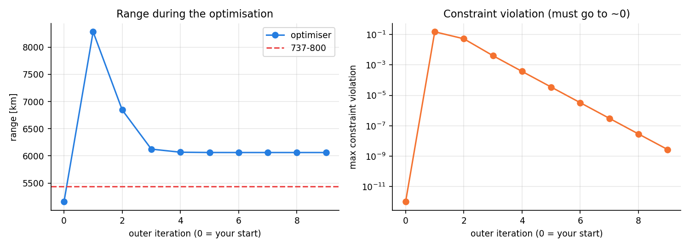
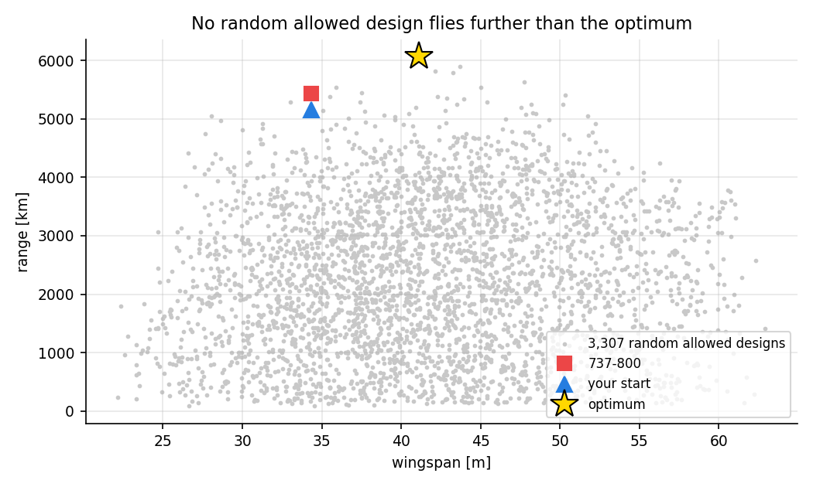

# Aircraft range optimiser: demo run 'composite_wing'

_Generated by scripts/demo_report.py on 2026-11-26 20:22. Augmented Lagrangian + BFGS (our own code), checked with SciPy SLSQP._

## Your inputs

| Input | Value | 737-800 default |
|---|---|---|
| Passengers (100 kg each incl. bags) | 162 | 162 |
| Maximum take-off mass [kg] | 79,016 | 79,016 |
| Cruise altitude [ft] | 35,000 | 35,000 |
| Engine fuel burn factor | 1.0 | 1.0 |
| Maximum stall speed [m/s] | 64.0 | 64.0 |
| Maximum cruise Mach | 0.8 | 0.8 |
| Wing structure factor | 0.8 | 1.0 |
| Maximum wingspan [m] | no limit | no limit |
| Start: wingspan [m] | 34.32 | 34.32 |
| Start: wing area [m²] | 124.6 | 124.6 |
| Start: cruise Mach | 0.785 | 0.785 |
| Start: cruise fuel [kg] | 17,000 | 17,000 |

## Designs

|  | Your start | 737-800 | Optimum |
|---|---|---|---|
| Range [km] | 5,157 | 5,436 | 6,062 |
| Wingspan [m] | 34.3 | 34.3 | 41.1 |
| Wing area [m²] | 124.6 | 124.6 | 138.5 |
| Aspect ratio | 9.45 | 9.45 | 12.20 |
| Cruise Mach | 0.785 | 0.785 | 0.800 |
| Cruise fuel [kg] | 17,000 | 18,316 | 18,973 |
| Initial mass [kg] | 75,892 | 78,429 | 79,016 |
| Wing mass [kg] | 4,470 | 5,691 | 5,622 |
| Tank capacity [kg] | 20,816 | 20,816 | 21,473 |
| L/D | 16.98 | 17.07 | 18.09 |
| Stall speed [m/s] | 61.2 | 62.3 | 59.3 |

The 737-800 column is the real 737-800 (its own wing and wing mass) at Mach 0.785, flown under YOUR requirements with as much fuel as its tanks and the MTOW allow.

Your starting design satisfies every constraint.

## Result

- **Optimised range: 6,062 km** (+906 km vs your start).
- Versus the 737-800 under the same requirements: +627 km (+11.5 %).
- Solver: converged = True, 9 outer / 215 inner iterations, 0.03 s.

_Range and constraint violation at every outer iteration (0 = your start). An infeasible start can fly 'further' until the violation is forced to zero._

## Is it really the optimum? Independent checks

| Check | Result | Passed |
|---|---|---|
| 1. SciPy SLSQP from your start | 6,062.4 km | yes |
| 2. Our solver from 5 random starts | 6,062.4, 6,062.4, 6,062.4, 6,062.4, 6,062.4 km | yes |
| 3. 3,307 random allowed designs (of 20,000) | best 5,900 km | yes |
| 4. KKT: stationarity / complementarity | 7.5e-09 / 6.9e-09 | yes |
| 5. Second-order condition | +0.362 | yes |

Checks 1-3 are numerical evidence that the optimum is global within the bounds, not a proof. Checks 4-5 show it is a strict local minimum.

_Random allowed designs (grey) vs the optimum (star)._

## What limits the range

Each active constraint has a KKT multiplier λ. Because the objective is −ln R and every constraint is normalised, λ is the % range gained per 1 % relaxation:

- **MTOW** (λ = 2.506): raising the maximum take-off mass by 1 % gives about +2.51 % range
- **fuel volume** (λ = 0.376): making the fuel tanks 1 % bigger gives about +0.38 % range
- **Mach limit** (λ = 0.237): raising the Mach limit by 1 % gives about +0.24 % range

Not limiting (multiplier 0): stall speed.

## Limits of this model

Conceptual model calibrated on the 737-800: Breguet cruise, no wave drag (Mach cap instead), empirical wing mass and tank volume. Numbers are model predictions, not a validated aircraft.
