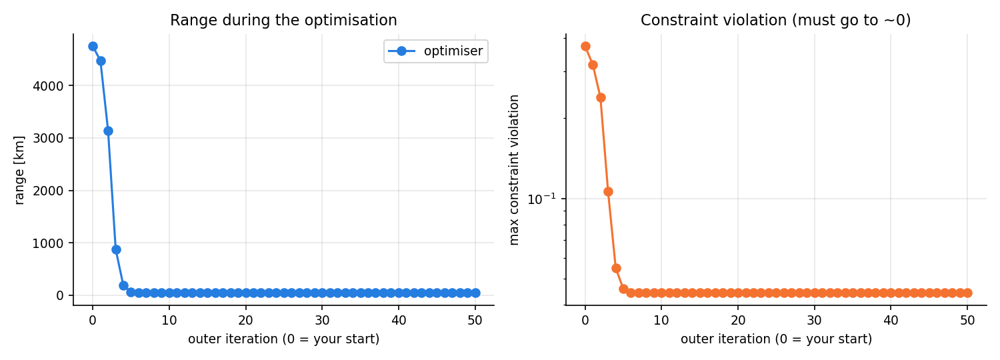

# Aircraft range optimiser: demo run 'impossible'

_Generated by scripts/demo_report.py on 2026-11-26 20:22. Augmented Lagrangian + BFGS (our own code), checked with SciPy SLSQP._

## Your inputs

| Input | Value | 737-800 default |
|---|---|---|
| Passengers (100 kg each incl. bags) | 213 | 162 |
| Maximum take-off mass [kg] | 60,000 | 79,016 |
| Cruise altitude [ft] | 35,000 | 35,000 |
| Engine fuel burn factor | 1.0 | 1.0 |
| Maximum stall speed [m/s] | 64.0 | 64.0 |
| Maximum cruise Mach | 0.8 | 0.8 |
| Wing structure factor | 1.0 | 1.0 |
| Maximum wingspan [m] | no limit | no limit |
| Start: wingspan [m] | 34.32 | 34.32 |
| Start: wing area [m²] | 124.6 | 124.6 |
| Start: cruise Mach | 0.785 | 0.785 |
| Start: cruise fuel [kg] | 17,000 | 17,000 |

## Designs

|  | Your start | Best attempt |
|---|---|---|
| Range [km] | 4,751 | 44 |
| Wingspan [m] | 34.3 | 21.6 |
| Wing area [m²] | 124.6 | 94.0 |
| Aspect ratio | 9.45 | 4.98 |
| Cruise Mach | 0.785 | 0.800 |
| Cruise fuel [kg] | 17,000 | 185 |
| Initial mass [kg] | 82,371 | 62,658 |
| Wing mass [kg] | 5,849 | 2,952 |
| Tank capacity [kg] | 20,816 | 18,811 |
| L/D | 17.16 | 12.25 |
| Stall speed [m/s] | 63.8 | 64.1 |

The 737-800 cannot carry this payload within this MTOW, so it is not shown.

**Your starting design is NOT allowed.** It breaks: MTOW (by 37.3 %). Its range is what it would fly, but it is not an acceptable aircraft.

## Result

**No design satisfies all the requirements** (smallest violation reached 4.4e-02). The requirements contradict each other, e.g. too much payload for the MTOW, or a stall speed so low that no wing within the bounds meets it.

_Range and constraint violation at every outer iteration (0 = your start). An infeasible start can fly 'further' until the violation is forced to zero._

## Limits of this model

Conceptual model calibrated on the 737-800: Breguet cruise, no wave drag (Mach cap instead), empirical wing mass and tank volume. Numbers are model predictions, not a validated aircraft.
