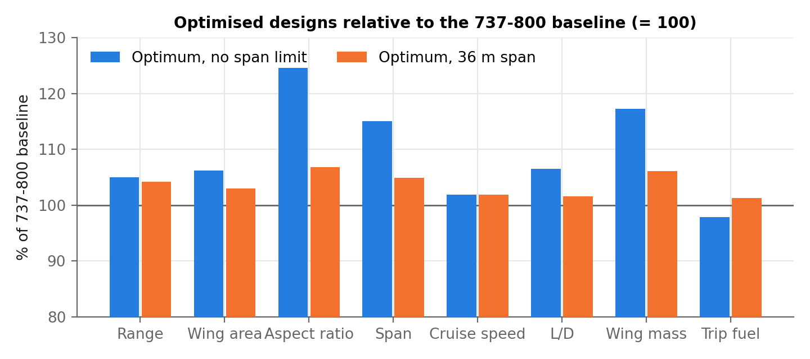
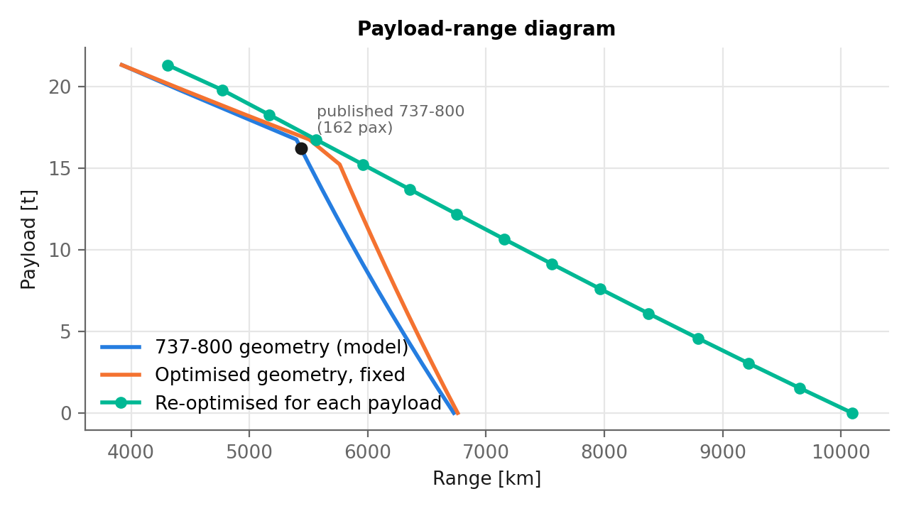
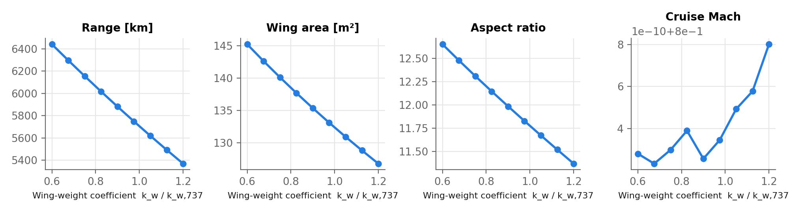
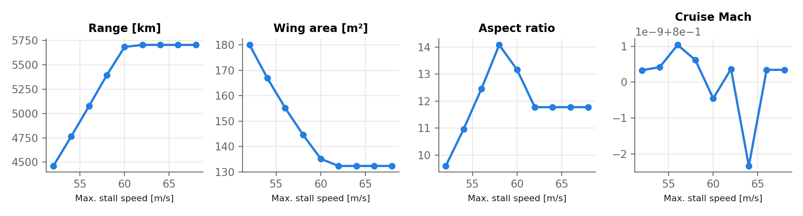
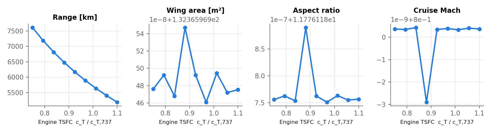
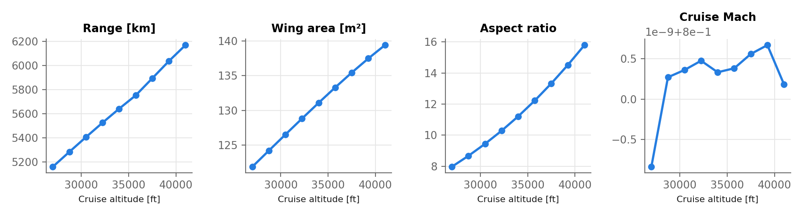
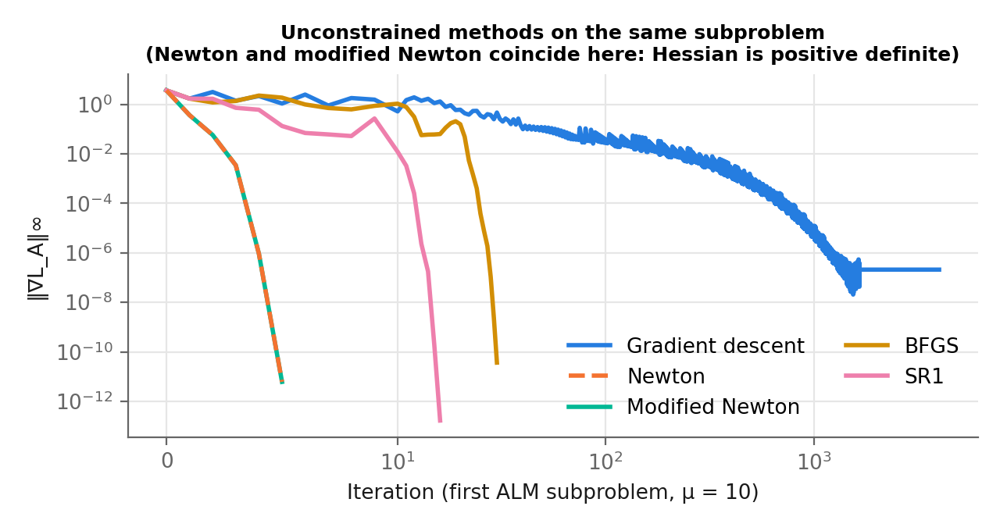
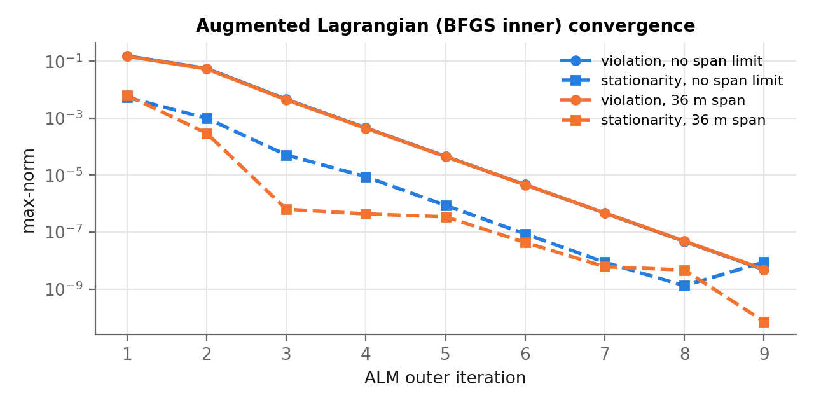
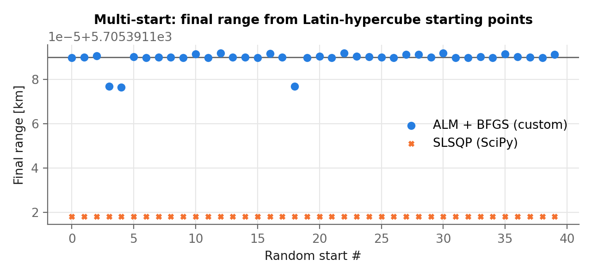

# Multivariable Constrained Optimisation of Aircraft Design for Maximum Flight Range

AIT 203 Optimisation. Project report. All numbers are reproduced by `python scripts/run_all.py`;
full tables are in `results/summary.md` and `results/tables/`.

## 1. Problem

We choose x = (S, AR, V, W_fuel, W_i) to maximise jet Breguet range, written as minimising its
negative logarithm:

min f(x) = −ln R,  R = (V/c_T)(C_L/C_D) ln(W_i/(W_i − W_fuel))

with C_L = 2W_i g/(ρV²S) and C_D = C_D0 + C_L²/(πe AR). The constraints are:

| Name | Constraint (normalised, ≤ 0 unless "= 0") |
|---|---|
| weight build-up (= 0) | (W_fixed + k_w S^a AR^b W_i^c + W_fuel + W_res + W_pay)/W_i − 1 |
| MTOW | W_i/MTOW − 1 |
| stall | (W_i g/S)/(½ρ₀V²_stall C_L,max) − 1 |
| fuel volume | (W_fuel + W_res)√AR/(k_f S^1.5) − 1 |
| Mach | V/(M_max a) − 1 |
| gate span (separate study) | √(S·AR)/b_max − 1 |
| bounds | x_min ≤ x ≤ x_max |

Taking the logarithm turns the product into a sum. As a result c_T only adds the constant ln c_T
to f, so **the optimal design does not depend on c_T** and range scales as 1/c_T (Section 5.4
confirms this). The problem is smooth and non-convex. Assumptions and every chosen value are
listed in `assumptions.md`.

## 2. Method

**Implementation.** The model is written in Python with NumPy, SciPy and Matplotlib. Gradients
and Jacobians are analytic, and the tests check them against finite differences to 1e-5 relative.
All variables are scaled to O(1).

**Custom solver** (`alm.py`, `unconstrained.py`):
- W_fuel is eliminated through the weight build-up, so W_fuel(S, AR, W_i) = W_i − W_fixed − W_wing − W_res − W_pay.
  Every iterate is therefore a weight-consistent aircraft, and the problem has 4 variables.
  The W_fuel bounds become inequality constraints.
- The remaining inequalities and bounds are handled by a Powell–Hestenes–Rockafellar augmented
  Lagrangian: L_A = f + (1/2μ) Σ[max(0, λᵢ + μgᵢ)² − λᵢ²]. After each subproblem the update is
  λ ← max(0, λ + μg), and μ grows ×10 when the violation stalls.
- Subproblems are solved by our own BFGS with Armijo backtracking (the default). Gradient descent,
  Newton, modified Newton (eigenvalue modification) and SR1 are run on the same subproblems
  for comparison. The objective returns +∞ outside the physical domain (W_fuel ≤ 0), and the
  line search backtracks.

**Reference solver.** SciPy SLSQP solves the original 5-variable formulation with the equality
constraint.

**Independent KKT check** (`reference.py`). At the returned design the check:
- finds the active set (equality, inequalities and bounds),
- solves ∇f + Jᵀλ = 0 by least squares, then checks stationarity, λ ≥ 0 and complementarity,
- computes the Hessian of the Lagrangian by differencing ∇L and projects it on the null space
  of the strongly active constraints (second-order condition).

**Calibration.** The model is calibrated to the Boeing 737-800 using public data (Section 4).
This is a consistency check, not independent validation.

## 3. Calibration against the 737-800

| | Value |
|---|---|
| Raymer wing mass at 737-800 geometry and MTOW | 5,688 kg, so W_fixed = 35,725 kg |
| Fuel-volume coefficient k_f (reproduces 20,816 kg of usable fuel) | 46.0 kg/m³ |
| Range predicted with literature TSFC 0.627 lb/lbf/h | 6,068 km (**+11.6 %** vs published 5,436 km) |
| Effective c_T reproducing the published range | 0.700 lb/lbf/h |

The 11.6 % over-prediction is expected: Breguet cruise ignores taxi, take-off, climb and
descent fuel and step-climb losses. Because c_T does not affect the optimal design (Section 1),
this calibration fixes the absolute range level but not the design trends. In the model the
baseline flies with full tanks at W_i = 78,429 kg, which is below MTOW, so its active limit is
fuel volume.

## 4. Optimised design vs the 737-800 baseline

Payload (16.2 t), MTOW, fuselage and systems mass are kept fixed.

| | 737-800 (model) | Optimum | Optimum, 36 m span |
|---|---|---|---|
| Range [km] | 5,436 | **5,705 (+4.96 %)** | **5,665 (+4.21 %)** |
| Wing area [m²] | 124.6 | 132.4 | 128.3 |
| Aspect ratio | 9.45 | 11.78 | 10.10 |
| Span [m] | 34.3 | 39.5 | 36.0 |
| Cruise Mach | 0.785 | 0.800 | 0.800 |
| L/D | 17.07 | 18.18 | 17.34 |
| Wing mass [kg] | 5,688 | 6,670 | 6,035 |
| Trip fuel [kg] | 18,316 | 17,921 | 18,555 |
| W_i [kg] | 78,429 | 79,016 (= MTOW) | 79,016 (= MTOW) |
| Active constraints | fuel volume | MTOW, fuel volume, Mach | MTOW, fuel volume, Mach, span |



How to read the optimum:
- The optimiser trades about 1 t of extra wing structure for a higher aspect ratio. L/D rises
  by 6.5 %, which outweighs carrying 2 % *less* trip fuel.
- Wing area grows just enough for the tanks to hold the fuel the MTOW allows, so the
  fuel-volume and MTOW constraints are active together.
- The speed goes to the Mach limit. Range ∝ V·L/D, and without wave drag nothing penalises speed
  up to M_max. This is a known artefact of replacing wave drag with a Mach cap.
- The wing-weight term stops AR well short of its bound of 16, as the proposal intended.
- The 36 m gate limit forces AR from 11.8 down to 10.1 but costs only 0.75 % of range.
  The optimiser recovers part of the loss through area and Mach.

## 5. Analysis

### 5.1 Payload–range



The figure shows three curves:
- **737-800 geometry**: the classic three-segment diagram. Range is MTOW-limited up to about
  16.7 t of payload, then tank-limited. The model reproduces the published point
  (5,436 km at 16.2 t) by construction.
- **Optimised geometry, fixed**: the nominal optimum flown at other payloads. It beats the 737
  at every payload, and most of all where its larger tanks matter (about +250 km at 13-15 t).
- **Re-optimised for each payload**: the best design for each mission. At low payload the
  optimiser picks a large, low-AR wing (S = 174 m², AR 8.4 at zero payload) to carry
  more fuel. At the 21.3 t structural maximum it picks a small, high-AR wing limited by stall.
  This envelope shows how strongly the best wing depends on the design mission.

### 5.2 Lighter structures (k_w)



Cutting wing-weight coefficient from 1.2× to 0.6× of the 737 value raises range from 5,369 to
6,441 km (about 3 % of range per 10 % of k_w). The optimal wing grows (S 127 to 145 m², AR 11.4 to 12.7),
because lighter structure makes span and area cheaper. The active set is unchanged.

### 5.3 Stricter stall speed



The stall limit is inactive above about 61 m/s. Below that it becomes active and replaces the
fuel-volume constraint, forcing a larger wing:

| V_stall,max | Wing area | Range | Range penalty |
|---|---|---|---|
| 58 m/s | 145 m² | 5,395 km | −5.4 % |
| 52 m/s | 180 m² | 4,461 km | −22 % |

The optimiser first answers a stricter limit by raising AR (up to 14 at 58 m/s) to recover L/D.

### 5.4 More efficient engines (c_T)



Range scales exactly as 1/c_T (from 5,187 to 7,607 km over 1.1× to 0.75×). As shown in
Section 1, the optimal design does not change. Engine technology and wing design decouple in
this model; in reality, engine weight and size would couple them.

### 5.5 Cruise altitude



Higher altitude increases range monotonically (5,162 km at FL270 to 6,168 km at FL410), and the
optimal AR rises from 8.0 to 15.8. The air is thinner, so C_L is higher, the induced-drag share
grows and span pays off more. The model has no thrust-lapse or buffet constraint, which in
reality would cap altitude. This trend should be read as "what span is worth at a given
altitude", not as a recommendation to fly at FL410.

### 5.6 KKT conditions, multipliers as sensitivities

Both optima pass the independent KKT check:

| Check | No span limit | 36 m span |
|---|---|---|
| Stationarity residual | 2·10⁻¹⁰ | 3·10⁻¹⁵ |
| Smallest multiplier | 0.35 | 0.16 |
| Complementarity | ~10⁻⁸ | ~10⁻⁸ |
| Second order | tangent space is 1-dimensional; reduced Hessian eigenvalue +0.40 | 5 linearly independent active constraints with positive multipliers (vertex); strict local minimum |

The multipliers of the scaled problem are elasticities: λ_i is the % gain in range per 1 %
relaxation of constraint i. By the envelope theorem, dR/dp = −R·∂L/∂p. Each prediction was
verified by re-solving with the parameter increased by 1 %:

| Parameter (no span limit) | dR/dp from KKT | Predicted ΔR (+1 %) | Re-solved ΔR |
|---|---|---|---|
| MTOW | **0.189 km per kg** | +149.2 km | +148.0 km |
| M_max | 2,471 km per unit Mach | +19.8 km | +19.4 km |
| Fuel-volume coefficient k_f | 45.8 km per unit | +21.1 km | +21.0 km |
| Payload | −0.260 km per kg | −42.1 km | −42.1 km |
| V_stall,max | 0 (inactive) | 0 | 0 |
| Span limit b_max (36 m case) | 24.6 km per m | +8.9 km | +8.3 km |

The small gaps between prediction and re-solve are the expected second-order effects of a 1 %
step. MTOW is by far the most valuable constraint to relax: each extra tonne of MTOW is worth
about 190 km, and an extra metre of gate span about 25 km.

### 5.7 Solver comparison

ALM outer loop with each inner method, started from the 737 baseline:

| Inner method | Inner iterations | ∇f evaluations | Time | Error vs SLSQP |
|---|---|---|---|---|
| Gradient descent | 24,395 | 24,405 | 14.9 s | 1·10⁻⁶ |
| Newton (FD Hessian) | 24 (3,020 with span) | 225 | 0.02 s (4.2 s) | 2·10⁻⁸ |
| Modified Newton | 24 | 225 | 0.02 s | 2·10⁻⁸ |
| **BFGS (default)** | 222 | 231 | 0.05 s | 2·10⁻⁸ |
| SR1 | 85 | 94 | 0.02 s | 2·10⁻⁸ |
| SLSQP (SciPy, reference) | 7 | 7 | 0.002 s | — |

All methods use 9-10 ALM outer iterations.




What the comparison shows:
- **Gradient descent** converges linearly and slowly. The penalty term makes the subproblem
  ill-conditioned (condition number grows with μ), and it stalls near ‖∇‖ ≈ 10⁻⁷.
- **Pure Newton** is excellent when the Hessian is positive definite. In the span-limited case
  one subproblem has an indefinite or near-singular Hessian, so it fell back to steepest descent
  and needed 3,020 iterations.
- **Modified Newton** fixes this with eigenvalue modification and is the most robust in
  iterations. Each of its iterations costs a Hessian, here 8 extra gradients by finite differences.
- **BFGS and SR1** reach superlinear convergence with only gradients. SR1 needed fewer
  iterations here.
- **SLSQP** is fastest in wall time. It is compiled code and solves the 5-variable problem with
  the equality constraint directly.

### 5.8 Multi-start



We ran 40 Latin-hypercube starting points spread over the whole box.
- All 40 ALM runs and all 40 SLSQP runs reached the same design (5,705.4 km).
- No second local optimum was found.

This is numerical evidence, not proof, that the optimum is global within the bounds.

## 6. Limitations

- There is no wave drag, so the Mach limit is always active. The optimal speed is therefore set
  by M_max, not by aerodynamics.
- Altitude is fixed per run, and there is no thrust or buffet limit.
- c_T is constant and the engine has no weight or size model, so engine and airframe decouple.
- There is one cruise segment. Climb and descent fuel and step climbs are absorbed into the
  calibrated c_T.
- The wing-weight and fuel-volume relations are empirical scalings around the 737.
  Results far from it (AR > 14, S > 170 m²) are extrapolations.
- The stall constraint uses W_i rather than landing weight, as stated in the proposal.

## 7. Reproducibility

```
pip install -r requirements.txt
python -m pytest           # gradient, calibration, solver-agreement and KKT tests
python scripts/run_all.py  # regenerates results/ in about 90 s
```
