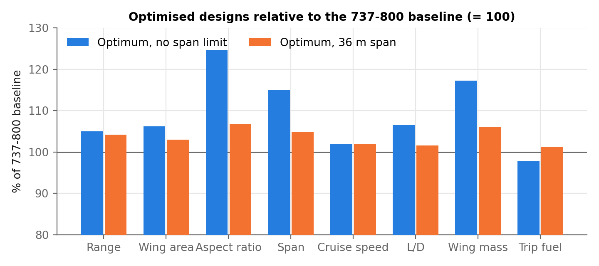
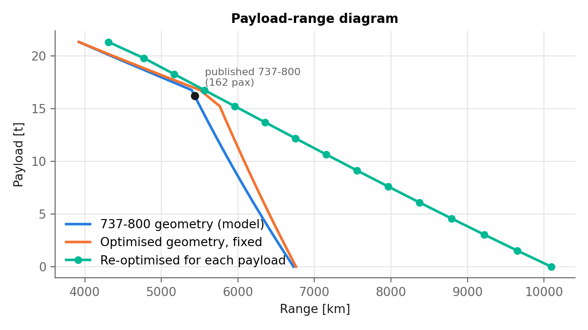
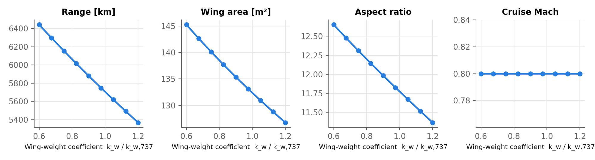
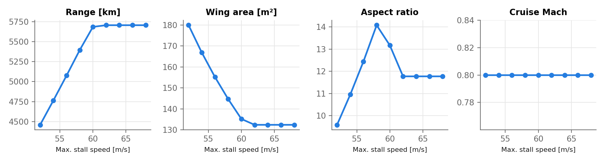
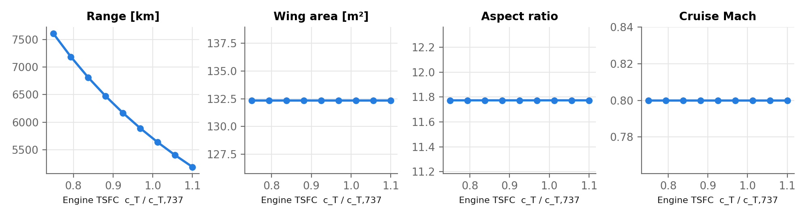
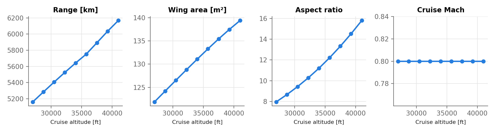
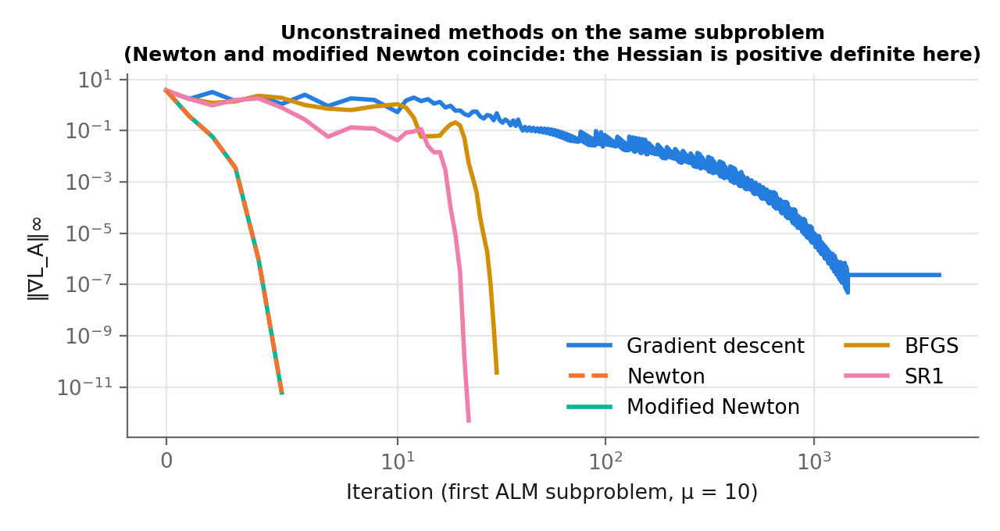
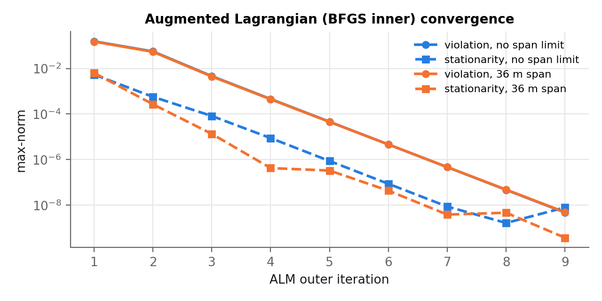
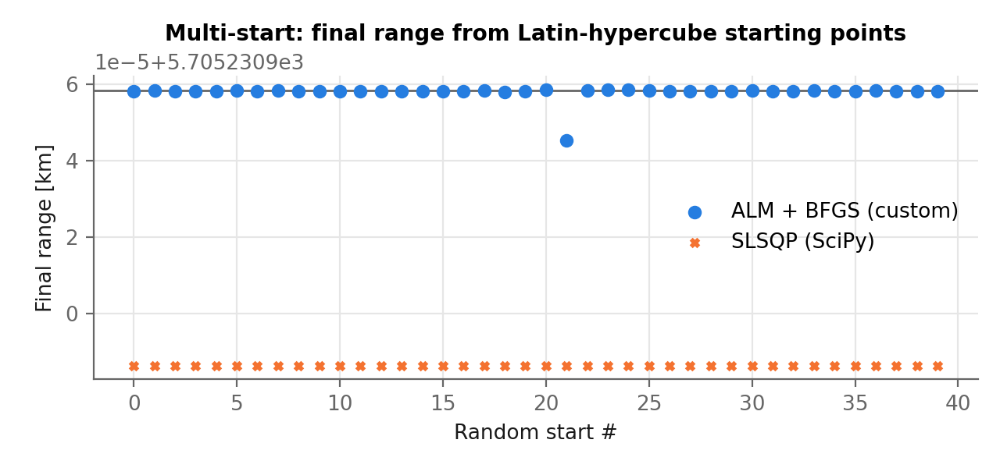

# Multivariable Constrained Optimisation of Aircraft Design for Maximum Flight Range

_AIT 203 Optimisation. Auto-generated by scripts/main_report.py on 2026-11-26 20:18 from results/results.json. Do not edit by hand._

## Problem

We choose the wing area S, aspect ratio AR, cruise speed V, fuel mass W_fuel and initial cruise mass W_i to maximise the jet Breguet range. Maximising R is the same as minimising f = −ln R, because ln is monotonic. The logarithm turns the product into a sum, which gives simpler gradients and makes every multiplier an elasticity (% range per % of a limit).

R = (V / c_T) · (C_L / C_D) · ln(W_i / (W_i − W_fuel)),   C_L = 2 W_i g / (ρ V² S),   C_D = C_D0 + C_L² / (π e AR)

| Constraint | Normalised form (≤ 0 unless = 0) | Meaning |
|---|---|---|
| weight build-up (= 0) | (W_fixed + k_w S^a AR^b W_i^c + W_fuel + W_res + W_pay) / W_i − 1 | the aircraft's mass adds up |
| MTOW | W_i / MTOW − 1 | not heavier than the maximum take-off mass |
| stall | (W_i g / S) / (½ ρ₀ V_stall² C_L,max) − 1 | slow enough to land |
| fuel volume | (W_fuel + W_res) √AR / (k_f S^1.5) − 1 | fuel fits in the wing |
| Mach | V / (M_max a) − 1 | replaces a wave-drag model |
| gate span (separate case) | √(S·AR) / b_max − 1 | fits a 36 m ICAO code C gate |
| bounds | x_min ≤ x ≤ x_max | keeps the search in a sensible box |

## Parameters and where they come from

Published values are Boeing 737-800 data. Calibrated values are fitted so that the model reproduces the 737-800 (Section 4). Assumed values are our choices and are listed with reasons in docs/assumptions.md.

| Parameter | Symbol | Value | Unit | Source |
|---|---|---|---|---|
| Maximum take-off mass | MTOW | 79,016 | kg | published (737-800) |
| Payload: 162 pax x 100 kg | W_pay | 16,200 | kg | assumed (standard pax + bag mass) |
| Reserve fuel (carried, not burnt) | W_res | 2,500 | kg | assumed |
| Zero-lift drag coefficient | CD0 | 0.02 | - | assumed (typical narrow-body) |
| Oswald efficiency | e | 0.8 | - | assumed (typical swept wing) |
| Max lift coefficient, landing flaps | CLmax | 2.6 | - | assumed (flapped narrow-body) |
| Maximum allowed stall speed | V_stall_max | 64 | m/s | assumed (737 baseline = 62.3 m/s fits) |
| Mach limit (replaces wave drag) | M_max | 0.8 | - | assumed (between cruise 0.785 and MMO 0.82) |
| Cruise altitude | h_cruise | 35,000 | ft | typical 737 cruise |
| Effective cruise TSFC | cT | 0.6999 | lb/(lbf h) | calibrated (literature 0.627) |
| Wing-mass exponent on S | a | 0.749 | - | Raymer eq. 15.25 (0.649 + 0.1 from S_cs) |
| Wing-mass exponent on AR | b | 0.5 | - | Raymer eq. 15.25 |
| Wing-mass exponent on W_i | c | 0.557 | - | Raymer eq. 15.25 |
| Wing-mass coefficient | k_w | 0.09368 | - | calibrated (Raymer mass at 737 geometry) |
| Fixed mass (OEW minus wing) | W_fixed | 35,722 | kg | calibrated (published OEW) |
| Fuel-volume coefficient | k_f | 46.02 | kg/m^3 | calibrated (published tank capacity) |

## Method

- **Elimination of W_fuel.** W_fuel appears linearly in the weight build-up, so the custom solver computes it from (S, AR, V, W_i). Every iterate is then a weight-consistent aircraft and the problem has 4 variables and inequality constraints only.
- **Augmented Lagrangian (our own).** L_A = f + (1/2μ) Σ [max(0, λᵢ + μ gᵢ)² − λᵢ²]. After each subproblem λ ← max(0, λ + μ g), which keeps λ ≥ 0. μ grows ×10 when the violation does not drop by a factor 4. A pure penalty method would need μ → ∞; the multiplier update keeps μ moderate and gives the KKT multipliers at the end.
- **Inner solvers (our own).** Gradient descent, Newton, modified Newton (H + ηI with η = δ − λ_min when λ_min ≤ 0), BFGS and SR1, all with Armijo backtracking (c₁ = 10⁻⁴, halving). Newton-type methods use a central-difference Hessian of the analytic gradient.
- **Reference solver.** SciPy SLSQP on the original 5-variable problem with the equality constraint. It checks both our solver and the W_fuel elimination.
- **Independent KKT check.** At the returned design, the multipliers are re-estimated by least squares on the active constraints, then stationarity, λ ≥ 0 and complementarity are tested, and the Hessian of the Lagrangian is projected on the tangent space (second-order condition).
- All variables are scaled to O(1) and all gradients are analytic (checked against finite differences in tests/).

## Calibration against the 737-800

| Item | Value |
|---|---|
| Published range (162 passengers) | 5,436 km (2935 nmi) |
| Raymer wing mass at 737-800 geometry | 5,691 kg, so W_fixed = 35,722 kg |
| Fuel-volume coefficient k_f | 46.02 kg/m³ |
| Range with literature TSFC 0.627 lb/lbf/h | 6,068 km (+11.6 %) |
| Effective TSFC that reproduces the published range | 0.700 lb/lbf/h (used everywhere) |

Breguet cruise ignores taxi, take-off, climb and descent, so it over-predicts range by 11.6 % with the literature TSFC. The effective TSFC absorbs these effects. Because c_T only adds the constant ln c_T to f, it changes the range level but **not the optimal design**. This is a consistency check, not an independent validation.

## Optimised design vs the 737-800

**Range gain: +4.96 % (no span limit), +4.21 % (36 m span)**

|  | 737-800 (model) | Optimum | Optimum, 36 m span |
|---|---|---|---|
| Range [km] | 5,436 | 5,705 | 5,665 |
| Wing area [m²] | 124.6 | 132.4 | 128.3 |
| Aspect ratio | 9.45 | 11.77 | 10.10 |
| Span [m] | 34.32 | 39.48 | 36.00 |
| Cruise Mach | 0.785 | 0.800 | 0.800 |
| L/D | 17.07 | 18.18 | 17.34 |
| C_L | 0.600 | 0.548 | 0.565 |
| Wing mass [kg] | 5,691 | 6,673 | 6,039 |
| Trip fuel [kg] | 18,316 | 17,921 | 18,555 |
| W_i [kg] | 78,429 | 79,016 | 79,016 |
| Stall speed [m/s] | 62.3 | 60.6 | 61.6 |
| Active constraints | fuel volume | MTOW, fuel volume, Mach limit | MTOW, fuel volume, Mach limit, gate span |

_Optimised designs relative to the 737-800 (= 100)._

- The optimiser adds 982 kg of wing for a higher aspect ratio (AR 9.45 → 11.77). L/D rises by 6.5 %, which outweighs the 2.2 % less trip fuel.
- Wing area grows just enough for the tanks to hold the fuel the MTOW allows, so MTOW and fuel volume are active together.
- The speed goes to the Mach limit: range ∝ V·L/D and without wave drag nothing penalises speed. This is a known artefact of replacing wave drag by a Mach cap.
- AR stops short of its bounds: the heavier wing (AR^0.5) and the smaller tank (1/√AR) balance the lower induced drag.
- The 36 m gate limit cuts the span from 39.5 m to 36.0 m. The wing area also shrinks (132.4 → 128.3 m²), so AR = b²/S only falls from 11.77 to 10.10. It costs 0.71 % of the unrestricted optimum's range.
- Our ALM and SLSQP agree to 1.8·10⁻⁸ (no span) and 2.0·10⁻⁸ (36 m) relative difference in x.

## Analysis

### Payload-range

_Payload-range diagram._

- **737-800 geometry**: the classic diagram, MTOW-limited at high payload and tank-limited at low payload. It passes through the published point by construction.
- **Optimised geometry, fixed**: the nominal optimum flown at other payloads; up to 259 km more than the 737.
- **Re-optimised for each payload**: at zero payload the best wing is S = 174 m², AR 8.4 (big tanks); at the 21.3 t structural maximum it is S = 119 m², AR 16.0 (active: MTOW, stall speed, Mach limit). The best wing depends strongly on the design mission.

### Lighter structures (k_w)

_Effect of the wing-weight coefficient._

Going from 1.20× to 0.60× the 737 wing-weight coefficient raises range from 5,368 to 6,441 km. The wing grows (S 127 → 145 m², AR 11.4 → 12.7) because lighter structure makes area and span cheaper.

### Stricter stall speed

_Effect of the maximum stall speed._

The stall limit is active for V_stall,max ≤ 60 m/s and inactive above. When active it forces a larger wing:

| V_stall,max [m/s] | Wing area [m²] | AR | Range [km] | vs unrestricted optimum |
|---|---|---|---|---|
| 52 | 180 | 9.59 | 4,460 | -21.8 % |
| 54 | 167 | 10.95 | 4,764 | -16.5 % |
| 56 | 155 | 12.45 | 5,075 | -11.0 % |
| 58 | 145 | 14.08 | 5,395 | -5.4 % |
| 60 | 135 | 13.17 | 5,684 | -0.4 % |

### More efficient engines (c_T)

_Effect of engine TSFC._

Range goes from 5,187 km at 1.10× to 7,607 km at 0.75× the TSFC. R × (c_T/c_T,737) stays constant to 2.1·10⁻¹⁰, so R ∝ 1/c_T exactly. The wing area changes by at most 5.5·10⁻⁹ (relative): as predicted, **the optimal design does not depend on c_T**. In reality engine weight and size would couple engine and airframe.

### Cruise altitude

_Effect of cruise altitude._

From 27,000 ft to 41,000 ft range goes from 5,162 to 6,167 km and the optimal AR from 8.0 to 15.8: thinner air needs a higher C_L, so induced drag matters more and span pays off. The model has no thrust lapse or buffet limit, so read this as 'what span is worth at a given altitude'.

## KKT conditions and multipliers as sensitivities

| Check | No span limit | 36 m span |
|---|---|---|
| Active | MTOW, fuel volume, Mach limit | MTOW, fuel volume, Mach limit, gate span |
| Stationarity residual | 3.4·10⁻¹⁰ | 6.7·10⁻¹⁶ |
| Smallest multiplier (≥ 0 needed) | 0.347 | 0.156 |
| Complementarity | 1.2·10⁻⁸ | 1.2·10⁻⁸ |
| Second order | tangent space 1-dim, reduced Hessian eigenvalue(s) +0.403 | vertex: active gradients span R⁵ with positive multipliers |

Both optima are strict local minima: yes. Because f = −ln R and every constraint is normalised, a multiplier λᵢ is the % range gained per 1 % relaxation of constraint i. By the envelope theorem dR/dp = −R ∂L/∂p. Each prediction was checked by re-solving with the parameter increased by 1 %:

**Sensitivities, no span limit**

| Parameter | dR/dp from KKT | Predicted ΔR (+1 %) | Re-solved ΔR |
|---|---|---|---|
| MTOW | 0.1888 km per kg | +149.2 km | +148.0 km |
| M_max | 2473 km per unit of Mach | +19.8 km | +19.4 km |
| k_f | 45.81 km per kg/m³ of k_f | +21.1 km | +21.0 km |
| W_pay | -0.2598 km per kg | -42.1 km | -42.1 km |
| V_stall_max | 0 km per m/s | +0.0 km | +0.0 km |

**Sensitivities, 36 m span**

| Parameter | dR/dp from KKT | Predicted ΔR (+1 %) | Re-solved ΔR |
|---|---|---|---|
| MTOW | 0.1814 km per kg | +143.3 km | +141.9 km |
| M_max | 3860 km per unit of Mach | +30.9 km | +29.7 km |
| k_f | 41.99 km per kg/m³ of k_f | +19.3 km | +19.2 km |
| W_pay | -0.2583 km per kg | -41.8 km | -41.8 km |
| V_stall_max | 0 km per m/s | +0.0 km | +0.0 km |
| b_max | 24.57 km per m | +8.8 km | +8.3 km |

MTOW is the most valuable limit to relax: one extra tonne is worth about 189 km. The small gaps between prediction and re-solve are the second-order effects of a 1 % step.

## Solver comparison

ALM outer loop with each inner method, started from the 737-800 baseline.

**Solver comparison, no span limit**

| Method | Conv. | Outer it. | Inner it. | ∇f evals | Fallbacks | Capped subprobl. | Time [s] | Error vs SLSQP |
|---|---|---|---|---|---|---|---|---|
| Gradient descent | yes | 10 | 24,399 | 24,409 | 0 | 8 | 29.821 | 1.1·10⁻⁶ |
| Newton (FD Hessian) | yes | 9 | 24 | 225 | 2 | 0 | 0.032 | 1.8·10⁻⁸ |
| Modified Newton | yes | 9 | 24 | 225 | 0 | 0 | 0.039 | 1.8·10⁻⁸ |
| BFGS (default) | yes | 9 | 219 | 228 | 0 | 0 | 0.082 | 1.8·10⁻⁸ |
| SR1 | yes | 9 | 115 | 124 | 7 | 0 | 0.023 | 1.8·10⁻⁸ |
| SLSQP (SciPy, reference) | yes | 7 | - | 7 | 0 | 0 | 0.002 | 0 |

**Solver comparison, 36 m span**

| Method | Conv. | Outer it. | Inner it. | ∇f evals | Fallbacks | Capped subprobl. | Time [s] | Error vs SLSQP |
|---|---|---|---|---|---|---|---|---|
| Gradient descent | yes | 9 | 11,444 | 11,453 | 0 | 3 | 21.140 | 2.6·10⁻⁸ |
| Newton (FD Hessian) | yes | 9 | 22 | 207 | 1 | 0 | 0.029 | 2.0·10⁻⁸ |
| Modified Newton | yes | 9 | 22 | 207 | 0 | 0 | 0.029 | 2.0·10⁻⁸ |
| BFGS (default) | yes | 9 | 184 | 193 | 0 | 0 | 0.058 | 2.0·10⁻⁸ |
| SR1 | yes | 9 | 125 | 134 | 13 | 0 | 0.050 | 2.0·10⁻⁸ |
| SLSQP (SciPy, reference) | yes | 4 | - | 4 | 0 | 0 | 0.001 | 0 |

_Inner methods on the same first ALM subproblem._

_ALM outer convergence (BFGS inner solver)._

- **Gradient descent** needs 24,399 inner iterations and hits the iteration cap in 8 subproblem(s). Growing μ makes L_A ill-conditioned (the term μ∇g∇gᵀ) and steepest descent zig-zags; it converges only linearly.
- Without the span limit, **Newton** takes 24 inner iterations with 2 fallback(s) to −∇f, where the Hessian was not positive definite; **modified Newton** takes 24 with 0 fallbacks, because the eigenvalue shift always gives a descent direction.
- With the span limit, **Newton** takes 22 inner iterations with 1 fallback(s) to −∇f, where the Hessian was not positive definite; **modified Newton** takes 22 with 0 fallbacks, because the eigenvalue shift always gives a descent direction.
- **BFGS** (219 iterations, 0 resets) and **SR1** (115 iterations, 7 resets) need only gradients. SR1's matrix is not guaranteed positive definite, so it sometimes gives a non-descent direction and we reset it; BFGS keeps it positive definite whenever sᵀy > 0.
- **SLSQP** is fastest in wall time: it is compiled code and solves the 5-variable problem directly.

## Multi-start

_Final range from Latin-hypercube starting points._

40 Latin-hypercube starting points over the whole box: ALM converged in 40, SLSQP succeeded in 40. Distinct final ranges (0.1 km rounding): 5,705.2 km. This is numerical evidence, not proof, that the optimum is global within the bounds (the problem is non-convex).

## Convergence audit

All 51 optimisations inside the payload-range and sweep studies converged, and each agrees with SLSQP to better than 10⁻⁵ (relative, in x).

## Limitations

- No wave drag, so the Mach limit is always active and sets the speed.
- Fixed altitude per run, no thrust or buffet limit; constant L/D and c_T in cruise (Breguet).
- No engine weight or size model, so engine and airframe decouple.
- One cruise segment; climb, descent and step climbs are absorbed into the calibrated c_T.
- Wing mass and fuel volume are empirical scalings around the 737; designs far from it (AR > 14, S > 170 m²) are extrapolations. Wing mass is not a strength model.
- The stall constraint uses W_i rather than landing weight (conservative), as in the proposal.
- Results are model-predicted and calibrated on one aircraft; they are not a validated redesign.

## Reproducibility

`pip install -r requirements.txt`, `python -m pytest`, `python scripts/run_all.py`. This run: 98 s, Python 3.13.12, NumPy 2.3.2, SciPy 1.16.3, Matplotlib 3.10.8. Every table is also in results/tables/ as CSV.

## Appendix: full tables

**Payload-range**

| Payload [kg] | 737 geometry [km] | Optimised, fixed [km] | Re-optimised [km] | Re-opt. S | Re-opt. AR | Active (re-opt.) |
|---|---|---|---|---|---|---|
| 0 | 6,728 | 6,760 | 10,095 | 174.0 | 8.43 | MTOW, fuel volume, Mach limit |
| 1,523 | 6,591 | 6,651 | 9,652 | 170.7 | 8.67 | MTOW, fuel volume, Mach limit |
| 3,046 | 6,458 | 6,544 | 9,218 | 167.3 | 8.93 | MTOW, fuel volume, Mach limit |
| 4,568 | 6,328 | 6,440 | 8,793 | 163.8 | 9.19 | MTOW, fuel volume, Mach limit |
| 6,091 | 6,201 | 6,337 | 8,374 | 160.1 | 9.47 | MTOW, fuel volume, Mach limit |
| 7,614 | 6,078 | 6,237 | 7,962 | 156.4 | 9.77 | MTOW, fuel volume, Mach limit |
| 9,137 | 5,957 | 6,138 | 7,554 | 152.5 | 10.08 | MTOW, fuel volume, Mach limit |
| 10,660 | 5,840 | 6,042 | 7,151 | 148.5 | 10.41 | MTOW, fuel volume, Mach limit |
| 12,182 | 5,725 | 5,947 | 6,751 | 144.3 | 10.76 | MTOW, fuel volume, Mach limit |
| 13,705 | 5,613 | 5,854 | 6,354 | 139.9 | 11.13 | MTOW, fuel volume, Mach limit |
| 15,228 | 5,504 | 5,763 | 5,958 | 135.4 | 11.52 | MTOW, fuel volume, Mach limit |
| 16,751 | 5,397 | 5,506 | 5,562 | 130.6 | 11.92 | MTOW, fuel volume, Mach limit |
| 18,273 | 4,900 | 4,965 | 5,166 | 125.7 | 12.35 | MTOW, fuel volume, Mach limit |
| 19,796 | 4,405 | 4,437 | 4,768 | 120.5 | 12.80 | MTOW, fuel volume, Mach limit |
| 21,319 | 3,922 | 3,921 | 4,307 | 118.8 | 15.97 | MTOW, stall speed, Mach limit |

**Sweep: Wing-weight coefficient  k_w / k_w,737**

| Value | Range [km] | S [m²] | AR | Span [m] | Mach | L/D | Active |
|---|---|---|---|---|---|---|---|
| 0.6 | 6,441 | 145.2 | 12.65 | 42.87 | 0.800 | 17.94 | MTOW, fuel volume, Mach limit |
| 0.675 | 6,297 | 142.6 | 12.48 | 42.19 | 0.800 | 18.00 | MTOW, fuel volume, Mach limit |
| 0.75 | 6,155 | 140.1 | 12.31 | 41.53 | 0.800 | 18.06 | MTOW, fuel volume, Mach limit |
| 0.825 | 6,017 | 137.7 | 12.14 | 40.89 | 0.800 | 18.11 | MTOW, fuel volume, Mach limit |
| 0.9 | 5,881 | 135.4 | 11.98 | 40.27 | 0.800 | 18.15 | MTOW, fuel volume, Mach limit |
| 0.975 | 5,749 | 133.1 | 11.83 | 39.67 | 0.800 | 18.17 | MTOW, fuel volume, Mach limit |
| 1.05 | 5,619 | 130.9 | 11.67 | 39.09 | 0.800 | 18.19 | MTOW, fuel volume, Mach limit |
| 1.125 | 5,492 | 128.8 | 11.52 | 38.52 | 0.800 | 18.19 | MTOW, fuel volume, Mach limit |
| 1.2 | 5,368 | 126.8 | 11.37 | 37.96 | 0.800 | 18.19 | MTOW, fuel volume, Mach limit |

**Sweep: Engine TSFC  c_T / c_T,737**

| Value | Range [km] | S [m²] | AR | Span [m] | Mach | L/D | Active |
|---|---|---|---|---|---|---|---|
| 0.75 | 7,607 | 132.4 | 11.77 | 39.48 | 0.800 | 18.18 | MTOW, fuel volume, Mach limit |
| 0.7937 | 7,188 | 132.4 | 11.77 | 39.48 | 0.800 | 18.18 | MTOW, fuel volume, Mach limit |
| 0.8375 | 6,812 | 132.4 | 11.77 | 39.48 | 0.800 | 18.18 | MTOW, fuel volume, Mach limit |
| 0.8813 | 6,474 | 132.4 | 11.77 | 39.48 | 0.800 | 18.18 | MTOW, fuel volume, Mach limit |
| 0.925 | 6,168 | 132.4 | 11.77 | 39.48 | 0.800 | 18.18 | MTOW, fuel volume, Mach limit |
| 0.9688 | 5,889 | 132.4 | 11.77 | 39.48 | 0.800 | 18.18 | MTOW, fuel volume, Mach limit |
| 1.013 | 5,635 | 132.4 | 11.77 | 39.48 | 0.800 | 18.18 | MTOW, fuel volume, Mach limit |
| 1.056 | 5,401 | 132.4 | 11.77 | 39.48 | 0.800 | 18.18 | MTOW, fuel volume, Mach limit |
| 1.1 | 5,187 | 132.4 | 11.77 | 39.48 | 0.800 | 18.18 | MTOW, fuel volume, Mach limit |

**Sweep: Max. stall speed [m/s]**

| Value | Range [km] | S [m²] | AR | Span [m] | Mach | L/D | Active |
|---|---|---|---|---|---|---|---|
| 52 | 4,460 | 179.9 | 9.59 | 41.54 | 0.800 | 15.08 | MTOW, stall speed, Mach limit |
| 54 | 4,764 | 166.9 | 10.95 | 42.75 | 0.800 | 16.18 | MTOW, stall speed, Mach limit |
| 56 | 5,075 | 155.2 | 12.45 | 43.94 | 0.800 | 17.32 | MTOW, stall speed, Mach limit |
| 58 | 5,395 | 144.6 | 14.08 | 45.13 | 0.800 | 18.50 | MTOW, stall speed, Mach limit |
| 60 | 5,684 | 135.2 | 13.17 | 42.19 | 0.800 | 18.70 | MTOW, stall speed, fuel volume, Mach limit |
| 62 | 5,705 | 132.4 | 11.77 | 39.48 | 0.800 | 18.18 | MTOW, fuel volume, Mach limit |
| 64 | 5,705 | 132.4 | 11.77 | 39.48 | 0.800 | 18.18 | MTOW, fuel volume, Mach limit |
| 66 | 5,705 | 132.4 | 11.77 | 39.48 | 0.800 | 18.18 | MTOW, fuel volume, Mach limit |
| 68 | 5,705 | 132.4 | 11.77 | 39.48 | 0.800 | 18.18 | MTOW, fuel volume, Mach limit |

**Sweep: Cruise altitude [ft]**

| Value | Range [km] | S [m²] | AR | Span [m] | Mach | L/D | Active |
|---|---|---|---|---|---|---|---|
| 2.7e+04 | 5,162 | 121.9 | 7.96 | 31.15 | 0.800 | 14.47 | MTOW, fuel volume, Mach limit |
| 2.875e+04 | 5,285 | 124.2 | 8.67 | 32.81 | 0.800 | 15.20 | MTOW, fuel volume, Mach limit |
| 3.05e+04 | 5,407 | 126.5 | 9.44 | 34.55 | 0.800 | 15.97 | MTOW, fuel volume, Mach limit |
| 3.225e+04 | 5,526 | 128.8 | 10.28 | 36.39 | 0.800 | 16.79 | MTOW, fuel volume, Mach limit |
| 3.4e+04 | 5,641 | 131.1 | 11.21 | 38.33 | 0.800 | 17.66 | MTOW, fuel volume, Mach limit |
| 3.575e+04 | 5,752 | 133.3 | 12.22 | 40.36 | 0.800 | 18.58 | MTOW, fuel volume, Mach limit |
| 3.75e+04 | 5,893 | 135.4 | 13.33 | 42.48 | 0.800 | 19.55 | MTOW, fuel volume, Mach limit |
| 3.925e+04 | 6,035 | 137.5 | 14.52 | 44.67 | 0.800 | 20.56 | MTOW, fuel volume, Mach limit |
| 4.1e+04 | 6,167 | 139.4 | 15.79 | 46.92 | 0.800 | 21.60 | MTOW, fuel volume, Mach limit |
